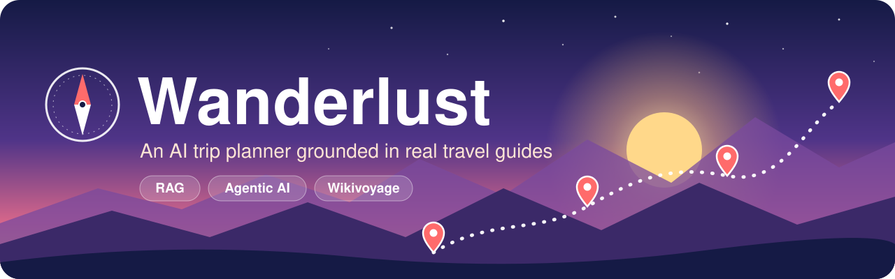
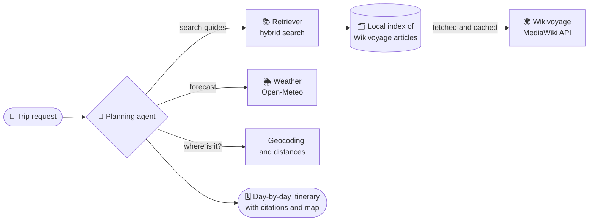
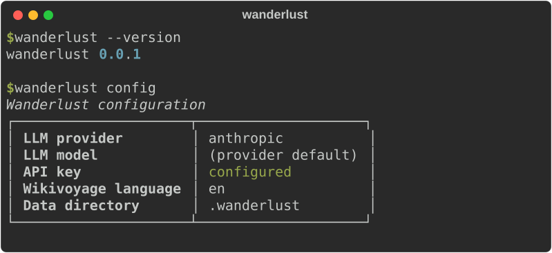

<p align="center">
  
</p>

<p align="center">
  <a href="https://github.com/sundusaijaz/wanderlust/actions/workflows/ci.yml"></a>
  
  <a href="LICENSE"></a>
  <a href="https://github.com/astral-sh/ruff"></a>
  <a href="ROADMAP.md"></a>
</p>

<p align="center">
  <b>Tell it where you want to go. Get a day-by-day plan you can trust.</b><br>
  <a href="#-how-it-works">How it works</a> ·
  <a href="#-getting-started">Getting started</a> ·
  <a href="ROADMAP.md">Roadmap</a> ·
  <a href="https://github.com/sundusaijaz/wanderlust/issues">Issues</a>
</p>

---

> *"5 days in Portugal in March. I love food and hiking, medium budget."*

Wanderlust turns a request like that into a day-by-day itinerary. Every
suggestion is backed by a cited passage from
[Wikivoyage](https://www.wikivoyage.org/), checked against the weather, and
shown on a map.

## ✨ Why Wanderlust

General-purpose chatbots happily invent restaurants that closed years ago and
hikes that do not exist. Wanderlust works differently:

| | |
|---|---|
| 📚 **Grounded** | Answers come from retrieved Wikivoyage passages (retrieval-augmented generation), and every stop links back to its source. |
| 🤖 **Agentic** | An LLM agent plans the trip step by step, calling tools to search guides, check the weather, find places and balance each day. |
| 🔍 **Transparent** | You can see which tools the agent used and why, instead of trusting a black box. |
| 🔑 **Your choice of model** | Works with OpenAI or Anthropic. Switch with one setting. |

## 🧭 How it works



1. **Fetch.** Wikivoyage articles for your destination are downloaded once,
   split into sections (See, Do, Eat, Sleep, Get around) and cached.
2. **Index.** Sections are chunked and indexed for both keyword and semantic
   search.
3. **Plan.** The agent breaks your request into steps, searches the guides,
   checks the weather and distances, and drafts each day.
4. **Cite.** The final itinerary links every recommendation to the passage it
   came from.

## 🗺️ Features

| Feature | Status |
|---|---|
| Configuration and command-line interface | ✅ Done |
| Wikivoyage client with caching | 🚧 Next ([#1](https://github.com/sundusaijaz/wanderlust/issues/1)) |
| Hybrid retrieval index | 📋 Planned ([#2](https://github.com/sundusaijaz/wanderlust/issues/2)) |
| OpenAI / Anthropic provider layer | 📋 Planned ([#3](https://github.com/sundusaijaz/wanderlust/issues/3)) |
| Grounded Q&A with citations | 📋 Planned ([#4](https://github.com/sundusaijaz/wanderlust/issues/4)) |
| Weather, geocoding and distance tools | 📋 Planned ([#5](https://github.com/sundusaijaz/wanderlust/issues/5)) |
| Planning agent | 📋 Planned ([#6](https://github.com/sundusaijaz/wanderlust/issues/6)) |
| Web UI, map view, export, Docker | 📋 Planned ([#7](https://github.com/sundusaijaz/wanderlust/issues/7)–[#10](https://github.com/sundusaijaz/wanderlust/issues/10)) |

See the full [roadmap](ROADMAP.md).

## 🚀 Getting started

```bash
git clone https://github.com/sundusaijaz/wanderlust.git
cd wanderlust
uv sync            # or: pip install -e .
cp .env.example .env
# edit .env: choose a provider and add its API key
uv run wanderlust --help
```

Check your setup at any time. API keys are never printed:

<p align="center">
  
</p>

## 🧰 Built with

| Area | Tools |
|---|---|
| Language | Python 3.11+, managed with [uv](https://docs.astral.sh/uv/) |
| Command line | [Typer](https://typer.tiangolo.com/) and [Rich](https://rich.readthedocs.io/) |
| Configuration | [Pydantic Settings](https://docs.pydantic.dev/latest/concepts/pydantic_settings/) |
| Language models | OpenAI or Anthropic APIs |
| Travel data | [Wikivoyage](https://www.wikivoyage.org/) via the MediaWiki API |
| Weather and places | [Open-Meteo](https://open-meteo.com/) (free, no key) |
| Quality | pytest, Ruff, GitHub Actions |

## 🛠️ Development

```bash
uv run pytest                               # run the tests
uv run ruff check .                         # lint
uv run ruff format .                        # format
uv run python scripts/render_screenshots.py # refresh README screenshots
```

Work is tracked in [issues](https://github.com/sundusaijaz/wanderlust/issues),
one per roadmap milestone, and lands through pull requests.

## 📜 Data and attribution

Travel content comes from [Wikivoyage](https://www.wikivoyage.org/) and is
available under the [Creative Commons Attribution-ShareAlike
license](https://creativecommons.org/licenses/by-sa/4.0/). Wanderlust fetches it
at runtime and does not redistribute it in this repository. Generated
itineraries link to the Wikivoyage articles they draw on.

## 📄 License

The Wanderlust source code is released under the [MIT License](LICENSE).
The banner artwork in `docs/assets/` was made for this project and is covered
by the same license.
